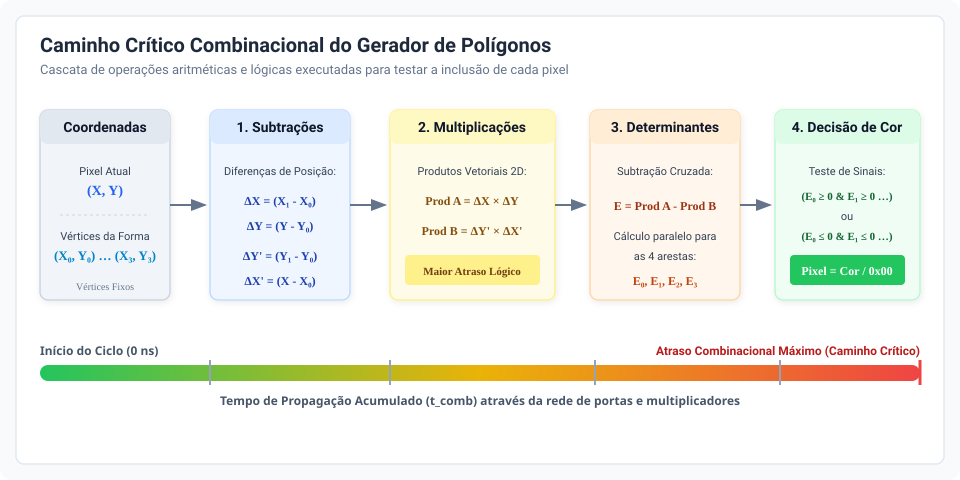
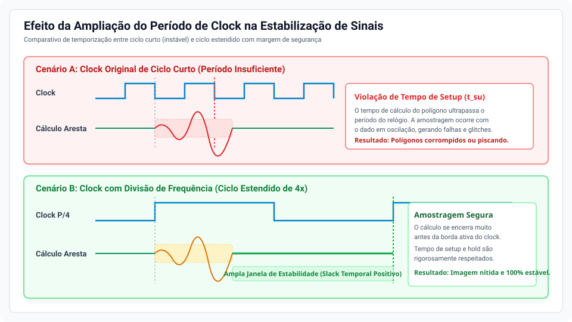

# CoProcessador Gráfico Programável

O CoProcessador Gráfico Programável desenvolvido é inspirado na arquitetura de consoles de 16 bits e possui três motores gráficos que trabalham em conjunto:

- Motor de background: tilemap de 40×30 posições com tiles de 8×8 pixels, com 256 padrões disponíveis, alteração individual de tiles e deslocamento vertical e horizontal (roll) da camada.
- Motor de sprites: até 64 sprites de 16×16 pixels, com prioridade, definição de posição, espelhamento horizontal e vertical, visibilidade e transparência.
- Rasterizador de polígonos: até 4 polígonos de 3 ou 4 vértices, com cor configurável.
  
A principal mudança do Problema 2 é que toda operação passa a ser consequência da execução de uma instrução da ISA definida pela equipe. Sendo assim, o controle dos motores, que antes era realizado pelo módulo `controlador_MEF` através da leitura das entradas `KEY` e `SW`, passou a ser feito por uma Unidade de Controle responsável por descodificar instruções de 32 bits. Além disso, a sincronização de comandos  deixou de ser através de um pulso de botão e passou a ser um protocolo de handshake utilizando os sinais `ativa`, `ready`, `valid` e `clear`. Já relacionado a software, que não existia na primeira fase, foi agora integrado um driver em Assembly ARM em conjunto com uma aplicação em C que possuide um menu. Por fim, como uma adição extra que não é parte dos requisitos do problema,  a ordem das camadas de polígonos e sprites, que anteriormente era fixa, passou a ser alternável. 

O projeto continua sendo executado na plataforma de desenvolvimento De1-SoC, descrito na linguagem de descrição de hardware Verilog, através do ambiente de desenvolvimento Quartus Prime, com saída VGA 640×480 a 60 Hz, a partir de uma resolução lógica de 320×240.

## Sumário
- [Fundamentação Teórica](#fundamentação-teórica)
  - [Protocolo de Handshake e Aplicação no Sistema](#protocolo-de-handshake-e-aplicação-no-sistema)
  - [Tempo de Propagação em Circuitos Digitais](#tempo-de-propagação-em-circuitos-digitais)
  - [Funcionamento da Unidade de Controle em Processadores](#funcionamento-da-unidade-de-controle-em-processadores)
- [Manual do Sistema](#manual-do-sistema)
  - [Requisitos do problema](#requisitos-do-problema)
  - [Arquitetura e Fluxo de Dados](#arquitetura-e-fluxo-de-dados)
    - [ISA](#isa)
  - [Teste Desenvolvido](#teste-desenvolvido)
- [Testes e erros](#testes-e-erros)
- [Manual de Uso](#manual-de-uso)
- [Conclusão](#conclusão)
- [Referências](#referências)
  
# Fundamentação Teórica

A compreensão e o desenvolvimento deste coprocessador gráfico programável fundamentam-se em conceitos centrais da engenharia de computadores e sistemas digitais: a sincronização entre domínios heterogêneos de processamento por meio de protocolos de *handshake*, a dinâmica temporal imposta pelo atraso de propagação dos sinais lógicos, e o princípio de funcionamento e organização das unidades de controle em arquiteturas de computadores.

## Protocolo de Handshake e Aplicação no Sistema

### Conceito Teórico
Em sistemas computacionais integrados, é recorrente a interação entre módulos que operam em frequências de *clock* diferentes, possuem latências de processamento distintas ou pertencem a domínios de temporização independentes (assíncronos entre si). Nesses cenários, a transferência de dados não pode ocorrer de forma incondicional ou contínua, pois haveria riscos de perda de dados (*overflow* do receptor) ou de leitura antes que os dados estivessem estáveis (*underflow* ou amostragem inconsistente).

O **protocolo de *handshake*** (ou aperto de mão) é um mecanismo de controle de fluxo e sincronização baseado na troca explícita de sinais de requisição e reconhecimento (confirmação). Em sua forma completa de quatro fases (*four-phase handshake* ou *full handshake*):
1. **Verificação e Envio**: O mestre averigua se o receptor está pronto (*Ready*). Se positivo, estabiliza os dados no barramento e ativa uma linha de requisição/ativação (*Request* ou *Ativa*).
2. **Reconhecimento**: O receptor detecta o sinal de ativação, captura os dados estáveis e aciona uma linha de confirmação (*Acknowledge* ou *Valid*), sinalizando que recebeu ou iniciou o processamento.
3. **Desativação da Requisição**: O mestre detecta a confirmação do receptor, abaixa a linha de requisição e sinaliza liberação (*Clear*).
4. **Restabelecimento**: O receptor percebe a desativação da requisição, desativa o sinal de confirmação e volta ao estado de prontidão (*Ready*), concluindo o ciclo de comunicação.

### Aplicação do Handshake no Projeto
No sistema desenvolvido na plataforma DE1-SoC, a comunicação se estabelece entre o **HPS** (*Hard Processor System*, com processador ARM Cortex-A9 rodando Linux) e o **Coprocessador Gráfico** implementado na malha de lógica programável da FPGA (operando com relógio próprio). A ponte de comunicação utilizada é a *Lightweight HPS-to-FPGA AXI Bridge*, cujos registradores são mapeados pelo *driver* em Assembly ARM (`driver.S`) através do mapeamento de memória física `/dev/mem` via chamada de sistema `mmap`.

Como o HPS executa o *software* em alta velocidade e sob o escalonamento do sistema operacional, o envio de cada instrução de 32 bits requer coordenação rigorosa com a máquina de estados do coprocessador. O protocolo foi materializado através de portas de entrada/saída paralelas (PIOs):

1. **`PIO_READY` (FPGA → HPS)**: O *driver* do HPS lê continuamente este registrador antes de transmitir qualquer instrução (`wait_ready`). A Unidade de Controle na FPGA só coloca `ready = 1` quando se encontra no estado `FETCH`, indicando capacidade de receber novas ordens.
2. **`PIO_INST` (HPS → FPGA)**: Barramento de 32 bits no qual o HPS escreve a palavra da instrução montada.
3. **`PIO_ATIVA` (HPS → FPGA)**: Após escrever a instrução, o HPS escreve `1` nesta porta para sinalizar a disponibilidade do dado. Na FPGA, esse sinal passa pelo módulo `rising_edge_detector.v`, gerando um pulso síncrono de exatamente um ciclo de *clock* (`ativa_pulse`), o que previne múltiplos disparos espúrios.
4. **`PIO_VALID` (FPGA → HPS)**: Ao entrar no estado `DECODE`, a Unidade de Controle gera um pulso de validação (`valid_pulse`). Para evitar que o HPS perca esse pulso rápido de hardware (devido à latência de leitura do barramento pelo Linux), foi incorporado o módulo `pulse_latch.v`. Este circuito funciona como uma trava de bit (*sticky ACK*), mantendo a linha `valid` em nível alto até intervenção do HPS.
5. **`PIO_CLEAR` (HPS → FPGA)**: Ao detectar `PIO_VALID == 1`, o HPS desativa `PIO_ATIVA` (escreve `0`) e pulsa a linha `PIO_CLEAR` (escreve `1`), acionando o reset da trava do `pulse_latch.v`. O *driver* aguarda a confirmação de descida de `PIO_VALID == 0`, finaliza a limpeza de `PIO_CLEAR` e encerra a transação com segurança garantida.

Esse fluxo estruturado elimina qualquer probabilidade de sobrescrita acidental de instruções no coprocessador e assegura que nenhuma instrução gráfica seja ignorada durante a execução da aplicação.

## Tempo de Propagação em Circuitos Digitais

### Fundamentação Teórica
Em circuitos lógicos digitais e semicondutores complementares (CMOS), os sinais não transitam instantaneamente entre os níveis lógicos $0$ e $1$. O **tempo de propagação** ($t_{pd}$ ou *propagation delay*) representa o intervalo de tempo decorrido entre a transição na entrada de uma porta lógica ou bloco funcional e a correspondente transição estável na sua saída (tipicamente medido no ponto de $50\%$ da excursão de tensão dos sinais).

Esse atraso é consequência direta de fenômenos físicos intrínsecos aos transistores de efeito de campo e às linhas condutoras da matriz da FPGA:
- **Resistência interna de canal** dos transistores durante a comutação;
- **Capacitâncias parasitas** de porta, dreno e das trilhas metálicas de interconexão (*interconnect delay*);
- **Topologia e profundidade lógica** da rede combinacional (número de portas em cascata até o destino).

### Restrições Temporais em Circuitos Síncronos
Em sistemas digitais síncronos regidos por relógio (*clock*), os tempos de propagação estabelecem o limite máximo para a frequência de operação ($f_{max} = 1 / T_{clk}$). Para que os dados sejam amostrados corretamente pelos registradores e *flip-flops* biestáveis, devem ser respeitadas duas condições essenciais:
1. **Tempo de *Setup* ($t_{su}$)**: O sinal de dados na entrada do registrador deve permanecer estável antes da borda ativa do *clock* por um intervalo mínimo $t_{su}$.
2. **Tempo de *Hold* ($t_{h}$)**: O sinal de dados deve continuar estável após a ocorrência da borda ativa do *clock* por um intervalo mínimo $t_{h}$.

A equação que rege o caminho crítico combinacional mais longo ($t_{comb\_max}$) é dada por:

$$T_{clk} \ge t_{co} + t_{comb\_max} + t_{su}$$

onde $t_{co}$ (*clock-to-output*) é o atraso entre a borda do clock e a saída do registrador de origem. Caso o atraso de propagação combinacional ultrapasse esse limite, ocorre violação de tempo de *setup*, levando o registrador a um estado de **metaestabilidade** (onde o biestável oscila ou assume tensão intermediária indefinida por período imprevisível, corrompendo a lógica do sistema).

### Relevância no Contexto do Projeto
No coprocessador gráfico em FPGA, coexistem blocos combinacionais extensos — como a geração e multiplexação de coordenadas para polígonos, cálculo de *bounding box*, endereçamento de memória RAM de blocos de fundo (*background*) e casamento de pixels na controladora VGA. 

O tempo de propagação impacta o projeto em dois eixos vitais:
1. **Integridade de Barramento e Handshake**: Entre a escrita do valor de 32 bits em `PIO_INST` pelo HPS e o disparo de `PIO_ATIVA`, os caminhos de roteamento da FPGA impõem tempos de propagação distintos a cada uma das 32 linhas de dados. A separação estrita adotada pelo *driver* — garantindo que os dados cheguem aos pinos do registrador antes da amostragem pelo pulso de ativação — previne que a Unidade de Controle capture valores intermediários ou incompletos decorrentes de tempos de propagação desiguais nas trilhas (*skew*).
2. **Pipelining e Estados da Unidade de Controle**: A transição escalonada em ciclos definidos (`FETCH` → `DECODE` → `SAVE`) garante que a decodificação de campos (bits de cor, tamanho, inversão de eixos e posições) esteja completamente estabilizada na lógica combinacional antes da ativação dos pulsos de escrita nos módulos de vídeo (`spr_salva_info`, `pol_salva_config`, etc.), garantindo margens de temporização (*slack*) seguras em toda a compilação do Quartus Prime.

## Funcionamento da Unidade de Controle em Processadores

### Princípio de Operação da Unidade de Controle
A **Unidade de Controle (UC)** é o elemento orquestrador de qualquer arquitetura de processamento digital. Enquanto o *Datapath* (caminho de dados) é responsável por armazenar valores e efetuar operações aritméticas e lógicas (através de registradores, ULA e memórias), a Unidade de Controle atua coordenando quando e como cada elemento do *datapath* deve agir.

Em uma CPU tradicional, a Unidade de Controle é responsável por governar o **ciclo de instrução**, tradicionalmente subdividido em:
- **Busca (*Fetch*)**: Obtenção da instrução na memória e armazenamento no Registrador de Instrução (IR);
- **Decodificação (*Decode*)**: Interpretação do código de operação (*opcode*) e identificação dos operandos e modos de endereçamento;
- **Execução (*Execute*)**: Habilitação dos sinais de controle adequados (seleção de funções na ULA, roteamento de multiplexadores, habilitação de leitura/escrita);
- **Armazenamento (*Write-back*)**: Atualização do estado dos registradores de destino ou gravação na memória.

### Modelos de Implementação: Cablada vs. Microprogramada
As unidades de controle são classicamente projetadas sob duas abordagens arquiteturais:
- **Unidade de Controle Cablada (*Hardwired Control Unit*)**: Implementada diretamente em lógica combinacional e sequencial com Máquinas de Estados Finitos (FSM). As transições e os sinais de controle são determinados por portas lógicas e registradores de estado. Caracteriza-se por baixíssima latência e máxima velocidade de processamento, sendo amplamente adotada em arquiteturas RISC e controladores dedicados em hardware/FPGA.
- **Unidade de Controle Microprogramada (*Microprogrammed Control Unit*)**: As sequências de controle para cada instrução são armazenadas como pequenas rotinas ("microinstruções") em uma memória interna de controle (*control store* ROM). Embora facilite modificações e suporte instruções complexas (típicas de arquiteturas CISC), introduz maior latência de execução decorrente da leitura contínua da memória de controle.

### A Unidade de Controle do Coprocessador Gráfico
No coprocessador desenvolvido, a Unidade de Controle (`UnidadeDeControle.v`) foi concebida segundo a abordagem **cablada**, utilizando uma Máquina de Estados Finitos síncrona integrada ao relógio do sistema.

A estrutura é organizada em torno de um Registrador de Instruções de 32 bits (`instrucao_reg`) e três estados fundamentais:
```
  +---------+    ativa == 1     +----------+                  +---------+
  |  FETCH  | ----------------> |  DECODE  | ---------------> |  SAVE   |
  |         | <---------------- |          |                  |         |
  +---------+   (fim do ciclo)  +----------+                  +---------+
     ready=1                       valid=1                    salva_* = 1
```

1. **Estado `FETCH` (2'b00)**: 
   - A UC mantém todas as linhas de controle de gravação desativadas (`*_salva_* <= 0`), sinaliza `ready <= 1` e `valid <= 0`.
   - Permanece em espera até que o sinal `ativa` (proveniente do detector de borda do handshake com o HPS) passe para nível alto.
   - Ao receber o pulso, transfere a palavra do barramento de 32 bits para o registrador interno `instrucao_reg` e comuta para o estado `DECODE`.
2. **Estado `DECODE` (2'b01)**:
   - A UC desativa a sinalização de `ready <= 0` e aciona `valid <= 1`.
   - Analisa o campo de *Opcode* formado pelos bits mais significativos (`instrucao_reg[31:29]`) e direciona os campos imediatos para os registradores de saída específicos de cada motor:
     - `3'b001`: Comando de **Reset** geral dos registradores;
     - `3'b010`: **Sprite Info** (extrai índice, ID do padrão e coordenadas X/Y);
     - `3'b011`: **Sprite Config** (extrai visibilidade e espelhamento Flip X / Flip Y);
     - `3'b100`: **Polygon Info** (extrai endereço do polígono, coordenada do vértice e posições X/Y);
     - `3'b101`: **Polygon Config** (extrai formato trapézio/retângulo, visibilidade e cor);
     - `3'b110`: **Background Info / Roll** (extrai coordenadas de *tile*, cor de fundo ou controle de rolagem);
     - `3'b111`: **Toggle Layer** (seleciona a prioridade de sobreposição de camadas).
   - Ao final do ciclo de *clock*, a máquina transita automaticamente para `SAVE`.
3. **Estado `SAVE` (2'b10)**:
   - Com todos os barramentos de dados já decodificados e propagados com estabilidade temporal, a UC asserta a linha de habilitação de escrita correspondente (`spr_salva_info`, `spr_salva_config`, `pol_salva_info`, `pol_salva_config`, `bg_salva_info` ou `geral_layer_save`).
   - Os motores gráficos capturam os valores em seus próprios registradores internos.
   - A máquina de estados retorna incondicionalmente para o estado `FETCH`, baixando os pulsos de escrita e reabilitando o sistema para a próxima instrução.

Dessa forma, a Unidade de Controle atua como o elo integrador entre a ISA de 32 bits emitida pelo software e as ações físicas dos motores de desenho no hardware.

# Manual do Sistema

O seguinte projeto marca a segunda fase de um problema, que tem como propósito a construção de um coprocessador programável, controlado por instruções de 32 bits enviadas pelo HPS (Hard Processor System) através de uma ISA e uma Unidade de Controle, além do desenvolvimento de um driver e uma aplicação teste em C, deixando a base pronta para a integração com o jogo na fase final.

## Requisitos do Problema

O desenvolvimento do coprocessador gráfico para a fase 2 exigiu a mudança do núcleo gráfico existente anteriormente para um coprocessador programável controlado por software, eliminando o controle manual dos módulos. A arquitetura precisa incorporar uma Unidade de Busca de Instruções, Unidade de Controle, Datapath, Registrador de Instruções (IR), banco de registradores e uma Unidade Lógica e Aritmética (ULA), e os motores de background, sprites e polígonos da fase anterior passam a operar como unidades funcionais integradas neste datapath.

A partir disso, o funcionamento do sistema passa a ser ditado pelo ciclo de busca e execução de uma Instruction Set Architecture (ISA) de 32 bits, definida pela equipe, sendo que qualquer operação gráfica exibida deve resultar da execução de uma instrução dessa mesma ISA. O fornecimento de instruções pode ser feito de forma ativa, lendo ficheiros executáveis (como .mif ou .hex) a partir de uma memória interna, ou de forma passiva, recebendo uma fila de comandos do processador ARM via MMIO através de um driver escrito na linguagem de montagem Assembly ARM. Porém, em ambos os casos, é necessária a criação de um programa de demonstração em Assembly que valide a funcionalidade da ISA.

A geração da imagem da saída VGA deve ser estável, a partir da resolução lógica 320X240, e operar de forma independente da execução de instruções pela Unidade de Controle, sendo necessária a inclusão de uma Unidade de Controle de Quadro, um Compositor, uma Controladora VGA.

O seguinte projeto marca a segunda fase de um problema, que tem como propósito a construção de um coprocessador programável, controlado por instruções de 32 bits enviadas pelo HPS (Hard Processor System) através de uma ISA e uma Unidade de Controle, além do desenvolvimento de um driver e uma aplicação teste em C, deixando a base pronta para a integração com o jogo na fase final.

## Arquitetura e Fluxo de Dados

O sistema integra a CPU ARM do HPS ao coprocessador gráfico na FPGA por meio de barramentos de memória mapeada (MMIO), permitindo que comandos emitidos por aplicações em software sejam convertidos em primitivas gráficas aceleradas por hardware. O fluxo global de interconexão entre as camadas do sistema pode ser visualizado no diagrama a seguir:


### ISA

A Instruction Set Architecture (ISA) estabelece a comunicação entre o software e o hardware do coprocessador, onde cada comando é uma palavra de 32 bits, onde os três bits mais significativos (`[31:29]`) atuam como o opcode, identificando qual operação realizar. Os 29 bits restantes variam dependendo do opcode, sendo mapeados em campos específicos que contêm os operandos da instrução. As secções marcadas com X representam bits não utilizados, que são utilizados apenas para completar a dimensão da palavra.

| Instrução | Opcode [31:29]  | Campos (do bit mais significativo ao menos) | Descrição  |
|:--------------:|:----:|:------:|:------:|
| `RESET` | 001 | X…X    | Zera os registradores de saída da UC e gera um pulso de reset nos motores   |
| `SPRITE_INFO` | 010 | camada[28:23] (6) · id[22:17] (6) · x[16:8] (9) · y[7:0] (8)    | Define posição e padrão de um sprite   |
| `SPRITE_CONFIG`  | 011 | X[28:9] · camada[8:3] (6) · visivel[2] · flipx[1] · flipy[0]    | Define visibilidade e espelhamento de um sprite    |
| `POL_INFO`  | 100 | X[28:21] · camada[20:19] (2) · vertice[18:17] (2) · x[16:8] (9) · y[7:0] (8)     | Define as coordenadas de um vértice de um polígono     |
| `POL_CONFIG`  | 101| X[28:12] · camada[11:10] (2) · visivel[9] · trapezio[8] · cor[7:0] (8)     | Define cor, visibilidade e formato de um polígono   |
| `BG_INFO`  | 110 | X[28:22] · funcao[21] · roll[20:19] (2) · x[18:13] (6) · y[12:8] (5) · cor[7:0] (8)    | Altera um tile do background ou o deslocamento (roll)    |
| `TOGGLE_LAYER ` | 111 |X[28:1] · layer[0]  | Define a ordem de desenho das camadas    |

### Interface HPS-CoProcessador

O protocolo segue o handshake de quatro fases descrito na [Fundamentação Teórica](#protocolo-de-handshake-e-aplicação-no-sistema), que foi mapeado da seguinte forma no hardware e no driver:

| PIO| Offset | Largura | Sentido (visto pelo HPS) | Sinal do coprocessador|
|:--------------:|:----:|:------:|:------:|:-------:|
| `pio_inst ` | 0x00 | 32   | saída | `instrucao` (entrada da UC)  |
| `pio_ativa  ` | 0x10 | 1  | saída | `ativa`, que passa pelo detector de borda   |
| `pio_ready  ` | 0x20 | 1  | entrada| `ready` (saída da UC)   |
| `pio_valid  ` | 0x30 | 1  | entrada| `sticky_ack` (saída do `pulse_latch`)   |
| `pio_clear  ` | 0x40 | 1  | saída | `clear_from_hps` (entrada do `pulse_latch`) |

Na primeira fase. a verificação e envio é conduzida pelo Driver (através de `wait_ready`), que lê o sinal `pio_ready` em pooling até que atinja o valor !, realizando em seguia a escrita em `pio_inst` e definindo `pio_ativa` = 1. A segunda fase, referente ao reconhecimento, é executada pela Unidade de Controle (UC) em conjunto com o `pulse_latch`: o sinal `ativa_pulse` leva a UC do estado `FETCH` para `DECODE`, gerando o `valid_pulse`, e o módulo `pulse_latch` atua retendo o sinal `pio_valid` = 1.

Na terceira fase, de desativação da requisição, o driver assume novamente o controle (via `wait_valid_1`) e, ao verificar a condição de `pio_valid` = 1, escreve `pio_clear` = 1 e reduz `pio_ativa` = 0. A quarta e última fase é operada de forma combinada pelo `pulse_latch` e pelo driver (`wait_valid_0`). Nesta etapa de encerramento do ciclo, o latch zera o sinal `pio_valid`, fazendo com que o driver aguarde a leitura de `pio_valid` = 0 para finalmente escrever `pio_clear` = 0.

O protocolo de quatro fases pode ser representado através do diagrama a seguir: IMAGEM

## Teste desenvolvido

O teste de validação do sistema é a sequência completa (opção 9 do menu da aplicação em C). Ela envia ao coprocessador, pelo HPS, um pequeno programa gráfico que usa todas as instruções operacionais da ISA e aciona os três motores ao mesmo tempo. Com isso, ela realiza o caminho completo: aplicação em C, driver em Assembly, handshake, Unidade de Controle, motores gráficos, compositor e saída VGA. 

A sequência de testes tem início com o envio da instrução `RESET`, limpando qualquer elemento que esteja na tela. Em seguida, a instrução `SPRITE_INFO 1, 5, 200, 200` é enviada para validar a escrita da parte info do sprite, com o padrão de identificação 5 e a posição (200, 200). O passo seguinte é o envio de `SPRITE_CONFIG 1, 1, 0, 1` para validar a escrita da parte config, testando se a imagem fica visível, sem espelhamento horizontal e com espelhamento vertical. O resultado visível esperado é o aparecimento do sprite já espelhado verticalmente, na posição 200, 200.

Seguidamente, a instrução `BG_INFO 0, 2, 10, 20, 255` é enviada para validar a escrita de um tile no background utilizando a instrução `funcao` = 0. Como consequência, o monitor deverá exibir o tile posicionado nas coordenadas (10, 20) com o padrão 255 no tilemap.

A quinta etapa envolve a repetição da instrução `POL_INFO 0, 0..3, ...` por quatro vezes para validar a escrita dos quatro vértices correspondentes ao polígono 0: (0,0), (100,0), (100,100) e (0,100). Nesta fase, nada aparece no monitor, visto que ainda falta definir a configuração de desenho da forma geométrica. O sexto teste utiliza a instrução `POL_CONFIG 0, 1, 0, 200` para validar a escrita de configuração final do polígono, ativando sua visibilidade com o formato `trapezio`= 0 e a cor 200. Então, a tela passará a mostrar um triângulo preenchido com a cor 200.

Por fim, a instrução `TOGGLE_LAYER 1` é enviada para testar a definição da ordem em que as camadas são desenhadas. 

Porém, há um problema nos testes desenvolvidos, pois as posições usadas não se sobrepõem. O polígono ocupa a região de 0,0 a 100,100, o sprite fica em 200,200. Por isso, a sequência não demonstra visualmente a prioridade entre as camadas de sprites e de polígonos. Para verificar essa funcionalidade, é necessário que o próprio usuário sobreponha um sprite com um polígono e altere a ordem das camadas. 

# Testes e Erros

## Estabilização Temporal e Ajuste de Clock no Motor de Polígonos

Durante o desenvolvimento desta fase, o módulo responsável pela rasterização de formas geométricas (triângulos e quadriláteros/trapézios) apresentou o maior desafio de temporização de todo o coprocessador gráfico. Para solucionar problemas de oscilação visual e garantir fidelidade geométrica na saída de vídeo, foram implementadas alterações que aumentaram o tempo entre os ciclos de *clock* dedicados à varredura e ao cálculo do motor de polígonos.

### A Complexidade dos Cálculos de Aresta
Diferente de elementos como blocos de fundo (*background*) ou *sprites* — que realizam predominantemente leituras indexadas em tabelas de memória —, o motor de polígonos necessita avaliar matematicamente a inclusão geométrica de cada pixel da tela em tempo real durante a varredura.

Para determinar se um pixel pertence ao interior da forma, o circuito executa o algoritmo do produto vetorial bidimensional para cada uma das arestas do polígono. Essa avaliação é estruturada em uma cascata estritamente combinacional:

1. **Subtração de Coordenadas**: Cálculo das distâncias relativas entre o pixel atual e os vértices da forma geométrica;
2. **Multiplicações Cruzadas com Sinal**: Multiplicação em ponto fixo dos vetores de deslocamento de cada aresta;
3. **Cálculo do Determinante da Aresta**: Subtração entre os produtos cruzados para encontrar o sinal resultante;
4. **Comparação de Fronteira**: Verificação lógica conjunta do sinal de todas as arestas simultaneamente;
5. **Decisão e Seleção de Cor**: Multiplexação condicional da cor da forma ou transparência.

Como essa cadeia de cálculos é realizada em paralelo para múltiplas arestas e múltiplos polígonos simultâneos, o sinal precisa atravessar uma sequência profunda de portas lógicas e blocos multiplicadores antes de gerar o pixel final:



### O Problema do Ciclo de Clock Curto
Quando o motor de polígonos operava diretamente sob a frequência mais alta do sistema, o intervalo de tempo entre duas bordas ativas de *clock* era extremamente estreito. 

Como as operações de multiplicação e subtração encadeadas demandam um tempo físico considerável para que as correntes transitem pelos transistores e as capacitâncias das trilhas se carreguem, o tempo de propagação combinacional ultrapassava a duração do ciclo. 

Dessa forma, a borda ativa do *clock* seguinte chegava antes que os resultados dos multiplicadores tivessem alcançado seus níveis de tensão finais estáveis. Essa violação do tempo de *setup* provocava a captura de dados em plena fase de transição (ruídos e valores espúrios), resultando em cintilações, falhas no preenchimento interno e deformações nos vértices dos polígonos exibidos na tela.

### O Mecanismo de Estabilização por Aumento do Período de Clock
Para sanar em definitivo essa limitação física, foi aplicada uma alteração arquitetural que estendeu o tempo entre os pulsos de relógio do motor de polígonos (reduzindo a frequência de varredura do módulo em quatro vezes em relação ao relógio base).

Ao multiplicar o período do ciclo de *clock*, estabeleceu-se uma dinâmica temporal favorável:

- **Acomodação Completa da Cadeia Matemática**: O tempo disponível entre pulsos passou a ser muito superior ao atraso máximo acumulado pelas subtrações, multiplicações e comparadores;
- **Criação de Ampla Janela de Estabilidade**: As contas complexas completam sua propagação logo na primeira porção do ciclo estendido. O sinal resultante atinge seu valor definitivo e permanece em repouso elétrico por um longo intervalo antes da borda de amostragem;
- **Eliminação de Violações e Glitches**: Com os tempos de *setup* e *hold* amplamente respeitados, o circuito de saída captura dados perfeitamente consistentes, eliminando a ocorrência de metaestabilidade e garantindo bordas nítidas e preenchimento sólido na imagem.

O diagrama comparativo abaixo ilustra a diferença de comportamento entre o ciclo original insuficiente e o ciclo estendido:



## Escrita única nos motores de sprites e polígonos

A primeira grande alteração necessária para que as instruções funcionassem da forma esperada foi nos motores de sprites e polígonos. No Problema 1, os motores `motorSprites_Blitter` e `motorPol` guardavam todos os atributos de cada elemento em um único array, com um único sinal de escrita. Toda escrita sobrescrevia a palavra inteira, o que funcionava porque a antiga máquina de estados controladora sempre entregava todos os campos juntos. Porém, com a ISA, os atributos passaram a chegar por instruções diferentes: 

| Elemento| Instrução “info” | Instrução “config” |
|:--------------:|:----:|:------:|
| Sprites | `SPRITE_INFO`: id, x, y  | `SPRITE_CONFIG`: visivel, flipx, flipy   |
| Polígonos | `POL_INFO`: coordenadas x, y de um vértice   | `POL_CONFIG`: cor, trapezio, visivel   |

Com uma só escrita, cada instrução sobrescreveria também os campos que não carrega. A solução foi dividir a palavra de cada elemento em duas partes, info e config, com um sinal de escrita para cada uma pois, dessa forma, cada escrita altera apenas a sua parte e preserva a outra. : 

| Motor | Escrita da parte info  | Escrita da parte config  |
|:--------------:|:----:|:------:|
| Sprites | `spr_write_en_info`   | `spr_write_en_config`   |
| Polígonos | pol_salva_info    | pol_salva_config    |

## Erro de largura na escrita de config do motor de _sprites_

Houve também, após a alteração citada acima, um erro de largura na escrita de config no motor de _sprites_. Na primeira versão da escrita de config havia `5'd0` onde deveria haver `6'd0`: 
```
versão com erro:

oam[spr_write_idx] <= {oam[spr_write_idx][31:9], spr_write_flip_x, spr_write_flip_y, spr_write_visivel, 5'd0};
```
A concatenação tinha 23 + 3 + 5 = 31 bits, mas `oam` tem 32 bits. Porém, o Verilog completa o bit mais significativo com zero e compila normalmente, e o efeito é que a palavra inteira era deslocada em um bit para baixo a cada escrita de config, “perdendo” o bit mais significativo de x. O resultado observado foi que _sprites_ apareciam na posição errada.

# Manual de Uso

## Requisitos:

- Placa DE1-SoC com Linux no HPS e acesso por terminal;
- Monitor e cabo VGA conectados à placa;
- Computador com o software Quartus Prime instalado para compilar e programar a FPGA;

## Instalação e configuração:

- Faça o download de todo o conteúdo do repositório;
- No Quartus Prime, abra o projeto com o arquivo `soc_system.qsf` e defina DE1_SOC_golden_top.v como top-level;
- Caso faça alguma alteração no código e deseje recompilar, utilize a ferramenta Compile Design no Quartus.

## Programação na placa:

- Conecte a placa DE1-SoC no computador via USB e conecte o monitor VGA à placa;
- No Quartus Prime, abra a ferramenta Programmer, clique em Add File, vá até a pasta do projeto e selecione arquivo compilado `soc_system.sof`;
- Verifique se a placa foi reconhecida no Hardware Setup e clique em Start para transferir o código para a placa.

## Uso:

- Abra a pasta onde os arquivos foram compilados;
- Abra o terminal dentro da pasta;
- Use os seguintes comandos no terminal:
```
cd /home/root
```
```
gcc -o aplicacao aplicacao.c driver.S
```
- Em seguida, execute através do comando:
```
sudo ./aplicacao
```
- Para usar o menu, digite o número da opção e pressione a tecla Enter. A aplicação pede cada campo da instrução, mostrando a faixa de valores válida entre os colchetes. Valores inválidos ou fora da faixa são recusados e o campo é solicitado novamente.

| Opção | Instrução | Faixa |
|:--------------:|:----:|:------:|
| 1 | Reset | nenhum |
| 2 | Set sprite info | camada [0-63], id [0-63], x [0-511], y [0-255] |
| 3 | Set sprite config | camada [0-63], visivel [0-1], flipx [0-1], flipy [0-1] |
| 4 | Set pol info | camada [0-3], vertice [0-3], x [0-511], y [0-255]  |
| 5 | Set pol config | camada [0-3], visivel [0-1], trapezio [0-1], cor [0-255]  |
| 6 | Set background info | funcao [0-1], roll [0-3], x [0-63], y [0-31], cor [0-255]  |
| 7 | Toggle layer | layer [0-1] |
| 8 | Ler PIOs | nenhum (mostra `PIO_READY` e `PIO_VALID`, usado para testes) |
| 9 | Sequência de teste completa | nenhum |
| 0 | Sair | nenhum |

Exemplo: colocar um sprite na tela

```
Opcao: 2
  camada [0-63]: 1
  id [0-63]: 5
  x [0-511]: 200
  y [0-255]: 200

Opcao: 3
  camada [0-63]: 1
  visivel [0-1]: 1
  flipx [0-1]: 0
  flipy [0-1]: 0
```

A instrução de info define a posição e o padrão; a de config torna o sprite visível. Para movê-lo depois, é necessário repetir a opção 2 com novas coordenadas, sem reenviar a opção 3.

Exemplo: desenhar um polígono

1. Opção 4, quatro vezes, com `vertice` de 0 a 3 e as coordenadas de cada vértice (a mesma camada nas quatro).
2. Opção 5 com a mesma camada, `visivel` = 1, o formato em trapezio e a cor (1 a 255; a cor 0 é transparente).

A opção 9 executa uma cena de demonstração completa (_sprite_, _background_, polígono e ordem de camadas). Rode ela primeiro para verificar se o sistema está funcionando.

# Conclusão

É possível concluir que os requisitos funcionais propostos para a segunda fase foram cumpridos com sucesso, visto que o sistema evoluiu de um conjunto de motores de desenho (sprites, polígonos e background) controlados manualmente por chaves e botões para um coprocessador programável, operando com uma ISA de 32 bits, com Unidade de Controle, uso do protocolo de _handshake_ e um _driver_ em _Assembly_ ARM acessado por uma aplicação em C, deixando o sistema preparado para a integração final com o jogo na fase 3. Além disso, o problema de sincronização visual apresentado no problema anterior foi solucionado, garantindo uma geração de imagem estável, outro requisito presente na fase 2. 

# Referências

  - All About Circuits. *Understanding Handshaking in Digital Communications*. Disponível em: [https://www.allaboutcircuits.com/technical-articles/understanding-handshaking-in-digital-communications/](https://www.allaboutcircuits.com/technical-articles/understanding-handshaking-in-digital-communications/).
  - All About Circuits. *Understanding Propagation Delay in Digital Circuits*. Disponível em: [https://www.allaboutcircuits.com/technical-articles/understanding-propagation-delay-in-digital-circuits/](https://www.allaboutcircuits.com/technical-articles/understanding-propagation-delay-in-digital-circuits/).
  - Intel Corporation. *Cyclone V Device Handbook, Volume 3: Hard Processor System Technical Reference Manual*. Disponível em: [Intel FPGA Documentation](https://www.intel.com/content/www/us/en/docs/programmable/683126/current/cyclone-v-hard-processor-system-technical.html).
  - Intel Corporation. *Embedded Design Handbook: HPS-FPGA Bridges*. Disponível em: [Intel HPS-FPGA Bridges Guide](https://www.intel.com/content/www/us/en/docs/programmable/683260/current/hps-fpga-bridges.html).
  - Intel Corporation. *Understanding Metastability in FPGAs* (Application Note 42). Disponível em: [Intel FPGA Metastability Guide](https://www.intel.com/content/dam/www/programmable/us/en/pdfs/literature/an/an042.pdf).
  - GeeksforGeeks. *Asynchronous Data Transfer – Handshaking*. Disponível em: [https://www.geeksforgeeks.org/asynchronous-data-transfer-handshaking/](https://www.geeksforgeeks.org/asynchronous-data-transfer-handshaking/).
  - GeeksforGeeks. *Control Unit and its Types in Computer Architecture*. Disponível em: [https://www.geeksforgeeks.org/control-unit-and-its-types/](https://www.geeksforgeeks.org/control-unit-and-its-types/).
  - Laboratório de Tecnologia da Computação (LTEC3 - LEDS / UEFS). *Recursos da Placa DE1-SoC e Cyclone V*. Disponível em: [https://sites.google.com/uefs.br/ltec3-leds/recursos](https://sites.google.com/uefs.br/ltec3-leds/recursos).
  - Manual da placa (DE1-SoC) e do dispositivo Cyclone V pode ser consultados na página de [Recursos do LTEC3 - LEDS] https://sites.google.com/uefs.br/ltec3-leds/recursos
  - PATTERSON, David A.; HENNESSY, John L. *Computer Organization and Design: The Hardware/Software Interface*. 5th ed. Morgan Kaufmann / Elsevier.
  - STALLINGS, William. *Computer Organization and Architecture: Designing for Performance*. 10th ed. Pearson Education.
   - WAKERLY, John F. *Digital Design: Principles and Practices*. 4th ed. Pearson Prentice Hall.
